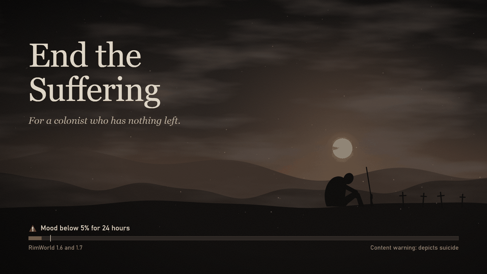

# End the Suffering



A RimWorld mod for realistic, grim playthroughs. A colonist who has been in despair for a long time can, on the player's explicit order, end their life with the firearm they carry.

> **Content warning:** this mod depicts suicide. If you are struggling yourself, please talk to someone. You can find a helpline in your country at [findahelpline.com](https://findahelpline.com).

## How it works

- The colonist's mood must stay below 5% for 24 in-game hours. Both values can be changed in the mod settings.
- Select the colonist and right-click them. An **End the suffering** entry with a red warning icon appears, followed by a confirmation dialog.
- The colonist stops and slowly raises the weapon to their head with shaking hands. Drafting them or giving another order cancels it.
- The result depends on the loaded round: small calibers destroy the brain, medium calibers the skull, and large calibers and shotguns the whole head.

The AI never does this on its own: the job starts only from the player's menu order. Children and teenagers are never eligible, and no setting changes that.

Bows, grenades, launchers and energy weapons don't qualify. A Combat Extended weapon needs a round in the magazine, and the shot uses it up.

## Compatibility

| Mod | Behaviour |
|---|---|
| Combat Extended | Optional. Ammo check, round use and caliber from the loaded ammo. |
| Show Me Your Hands | Optional. Hands follow the weapon. |
| [NL] Facial Animation | Optional. The face changes during the animation. |

Harmony is required.

Performance: the mood check runs at the game's normal mood interval, for player pawns only. Nothing ticks on pawns outside the animation.

### Test status

Tested on RimWorld 1.7.4998, alone and together with Combat Extended, Show Me Your Hands and Facial Animation. The 1.6 build compiles against the 1.6 API but has not been run in the game. Adding the mod to an existing save and larger mod lists have not been tested; please report conflicts with your `Player.log`.

Contact: Discord `bebranotyep`, or open an issue here.

## Building

Requires the .NET 10 SDK.

```powershell
./Source/build.ps1
```

This writes `1.6/Assemblies` and `1.7/Assemblies`. `-DevTest` adds the in-game test harness (`Source/DevTest.cs`), which must not ship.

## License

No license has been chosen yet. All rights reserved until one is added.
